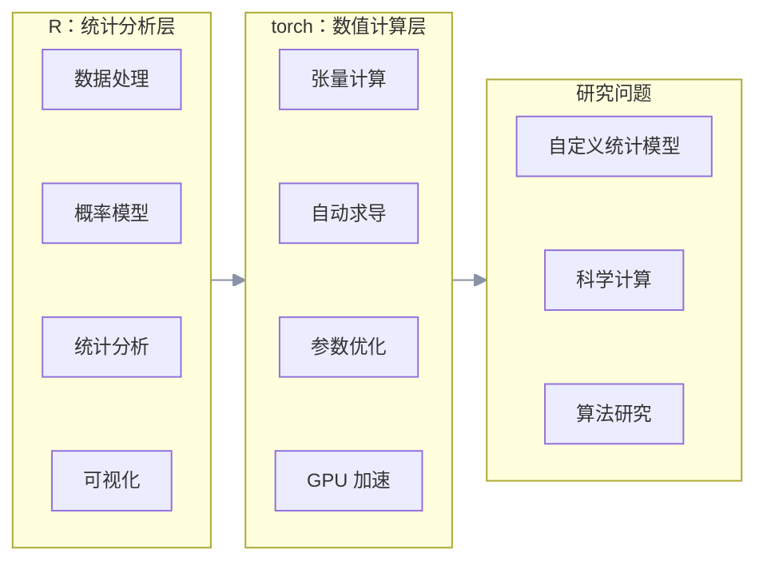
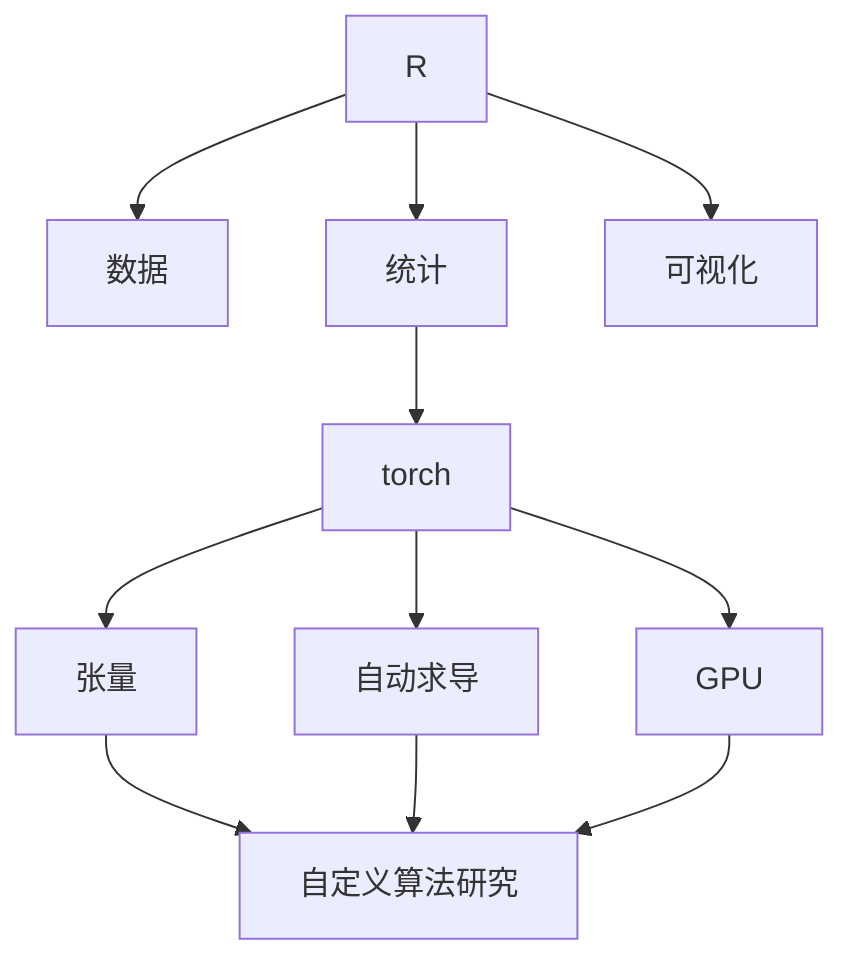

## 0 如果你的统计模型没人实现过呢？

做统计的人大概都有过这样的时刻。假设你有一个自己设计的概率模型。它不是 `lm()`，不是 `glm()`，不是 `lmer()`，甚至在 CRAN 上都找不到一个完全对应的函数。

你知道模型应该怎么写，也知道最终要优化一个似然函数。于是问题来了：

>梯度怎么办？

如果参数只有两个、三个，手推梯度还可以。但如果模型包含几十个参数、矩阵运算、非线性变换、积分或者随机模拟，事情马上变得复杂。

更麻烦的是，模型还没研究完，你就开始花大量时间写底层计算代码。于是很多统计研究者最后会走上一条熟悉的路：这个模型还是用 Python 写吧。

但这件事情其实值得重新思考。因为今天的 R 已经不只是一个"调用现成统计模型"的工具。

有了 [`mlverse/torch`](https://github.com/mlverse/torch) 之后，我们可以继续用 R 描述数据、统计模型和实验流程，同时把一部分复杂的数值计算交给 `torch`：



这套框架下，统计研究者可以在 R 里直接定义自己的数学模型，并让计算机自动完成求导、优化和大规模模拟。

下面用一个完整例子看看这件事情到底意味着什么。

---

## 1 从一个自定义概率模型说起

假设我们观察到一组数据，来自一个我们自己定义的混合分布：

$$
X \sim \pi N(\mu_1,\sigma_1^2) + (1-\pi)N(\mu_2,\sigma_2^2)
$$

也就是说：

- 一部分观测来自第一个正态分布；
- 另一部分来自第二个正态分布；
- 我们不知道两个分布的均值、标准差，也不知道混合比例。

需要估计：

$$
\theta = (\mu_1,\mu_2,\sigma_1,\sigma_2,\pi)
$$

这个模型当然不是多么复杂的统计模型，但它非常适合作为演示，因为我们可以完整地走一遍：

```text
定义概率模型 -> 写出对数似然 -> torch 自动求导 -> 优化参数 -> GPU 大规模模拟 -> 验证估计结果
```

整个过程不需要神经网络。

### 生成观测数据

先生成一组模拟数据。为了让后面的代码可以在没有 GPU 的电脑上运行，我们首先自动判断计算设备：

```r
library(torch)
set.seed(123)

device <- torch_device(
  if (cuda_is_available()) "cuda" 
  else if (backends_mps_is_available()) "mps" 
  else "cpu"
)

print(device)
```

依照真实参数 $\pi=0.35, \mu_1=-2, \sigma_1=0.7, \mu_2=2, \sigma_2=1.2$ 来生成观测数据：

```r
n <- 5000
z <- runif(n) < 0.35
x <- numeric(n)

x[z]  <- rnorm( sum(z), mean = -2, sd = 0.7)
x[!z] <- rnorm(sum(!z), mean = 2 , sd = 1.2)

x <- torch_tensor(x, dtype = torch_float(), device = device)
```

我们的任务是从数据中把它们估计出来。

### 自己定义概率模型

单个正态分布的密度为：

$$
p(x) = \frac{1}{\sqrt{2\pi}\sigma} \exp \left[ -\frac{(x-\mu)^2}{2\sigma^2} \right]
$$

为了数值稳定，我们直接使用对数密度：

$$
\log p(x) = -\frac12\log(2\pi) -\log\sigma -\frac{(x-\mu)^2}{2\sigma^2}
$$

混合模型则是：

$$
p(x) = \pi p_1(x) + (1-\pi)p_2(x)
$$

于是：

$$
\log p(x) = \log \left[ \pi p_1(x) + (1-\pi)p_2(x) \right]
$$

代码如下：

```r
log_normal_density <- function(x, mu, log_sigma ) {
  sigma <- torch_exp(log_sigma)
  -0.5 * log(2 * pi) - log_sigma - (x - mu)^2 / (2 * sigma^2)
}
```

然后定义整个混合模型的对数密度：

```r
log_mixture_density <- function(
  x, mu1, log_sigma1, mu2, log_sigma2, logit_pi) {

    log_pi <- -nnf_softplus(-logit_pi)
    log_one_minus_pi <- -nnf_softplus(logit_pi)
    
    log_p1 <- log_normal_density(x, mu1, log_sigma1)
    log_p2 <- log_normal_density(x, mu2, log_sigma2)

    torch_logsumexp(
      torch_stack(
        list(
          log_pi + log_p1,
          log_one_minus_pi + log_p2
        ),
        dim = 1
      ),
      dim = 1
    )
}
```

这里有两个值得注意的地方。

- 标准差不直接优化。我们优化 $\log\sigma$，然后 $\sigma=e^{\log\sigma}$，这样自然保证 $\sigma>0$。
- 混合比例也不直接优化。我们使用 $\pi=\operatorname{sigmoid}(a)$，这样无论参数 $a$ 取什么值，都有 $0<\pi<1$。

这是一种很常见的参数约束技巧，本质上是把一个有约束的优化问题，转化成了一个无约束优化问题——这也是自动求导框架特别擅长处理的场景：约束通过变换消化掉，剩下的梯度计算完全交给系统。

## 2 自动求导与参数优化

现在初始化参数：

```r
mu1 <- torch_tensor( -1, requires_grad = TRUE, device = device)
mu2 <- torch_tensor(  1, requires_grad = TRUE, device = device)

log_sigma1 <- torch_tensor( 0, requires_grad = TRUE, device = device)
log_sigma2 <- torch_tensor( 0, requires_grad = TRUE, device = device)
logit_pi   <- torch_tensor( 0, requires_grad = TRUE, device = device)
```

然后定义负对数似然：

```r
negative_log_likelihood <- function() {

  log_prob <- log_mixture_density(
    x, mu1, log_sigma1, mu2, log_sigma2, logit_pi
  )
  -log_prob$mean()
}
```

到这里，我们已经完成了最关键的一步：把一个统计模型写成了一个可以计算的函数。

我们没有手工推导 $\dfrac{\partial L}{\partial\mu_1}$，也没有推导 $\dfrac{\partial L}{\partial\sigma_1}$，更没有推导 $\dfrac{\partial L}{\partial\pi}$。这些工作交给 `torch`。

使用优化器：

```r
optimizer <- optim_adam(
  params = list(mu1, mu2, log_sigma1, log_sigma2, logit_pi),
  lr = 0.005
)
```

开始优化：

```r
for (step in 1:2000) {

  optimizer$zero_grad()
  loss <- negative_log_likelihood()
  loss$backward()
  optimizer$step()

  if (step %% 200 == 0) {
    # 在 with_no_grad 作用域中计算标量，防止生成新的计算图
    with_no_grad({
      sigma1 <- torch_exp(log_sigma1)
      sigma2 <- torch_exp(log_sigma2)
      pi_hat <- torch_sigmoid(logit_pi)
      

      cat(sprintf(
        "step = %04d loss = %.3f pi = %.3f u1 = %.3f s1 = %.3f u2 = %.3f s2 = %.3f\n",
        step, loss$item(), pi_hat$item(), mu1$item(),
        sigma1$item(), mu2$item(), sigma2$item()
      ))
    })
  }
}
```

这个过程中，你会观察到参数的收敛趋势：

```r
step = 0200 loss = 2.060 pi = 0.351 u1 = -1.765 s1 = 0.860 u2 = 1.620 s2 = 1.384
step = 0400 loss = 0.910 pi = 0.340 u1 = -2.038 s1 = 0.672 u2 = 1.907 s2 = 1.235
step = 0600 loss = 0.893 pi = 0.348 u1 = -2.012 s1 = 0.690 u2 = 1.994 s2 = 1.194
step = 0800 loss = 0.905 pi = 0.349 u1 = -2.007 s1 = 0.693 u2 = 2.007 s2 = 1.188
step = 1000 loss = 0.907 pi = 0.350 u1 = -2.007 s1 = 0.693 u2 = 2.008 s2 = 1.188
step = 1200 loss = 0.907 pi = 0.350 u1 = -2.007 s1 = 0.693 u2 = 2.008 s2 = 1.188
step = 1400 loss = 0.907 pi = 0.350 u1 = -2.007 s1 = 0.693 u2 = 2.008 s2 = 1.188
step = 1600 loss = 0.907 pi = 0.350 u1 = -2.007 s1 = 0.693 u2 = 2.008 s2 = 1.188
step = 1800 loss = 0.907 pi = 0.350 u1 = -2.007 s1 = 0.693 u2 = 2.008 s2 = 1.188
step = 2000 loss = 0.907 pi = 0.350 u1 = -2.007 s1 = 0.693 u2 = 2.008 s2 = 1.188
```

得到的结果接近我们最开始设定的真实参数：$\pi=0.35, \mu_1=-2, \sigma_1=0.7, \mu_2=2, \sigma_2=1.2$

如果观察后端 GPU 或 MPS 算力，你会发现会有短暂的占用（这个模拟算力占用时间很短）。

## 3 这个例子的重点

有人可能会说：混合正态模型 R 本来就能做。完全正确。所以这个例子的重点根本不是证明 `torch` 比某个现成统计包厉害。

关键点在于我们刚才没有调用任何现成的混合模型函数。我们只做了三件事情：

1. 定义概率密度
2. 定义损失函数
3. 调用自动求导和优化

因此，如果明天你的模型变成 $p(x|\theta)$，其中包含自定义变换、非标准分布、矩阵参数、正则化项、隐变量、数值近似、复杂的非线性结构——只要这个计算过程可以写出来，整体方法仍然成立。这才是 `torch` 对算法研究真正有吸引力的地方。

### 用一组耗时数据看"批量并行"到底是什么意思

参数估计完成以后，我们通常还会遇到另一个问题：模型到底拟合得怎么样？
一种自然的方法是从估计出来的模型重新生成大量数据，看看和真实数据是否吻合。
顺便，这也是一个很好的机会去实际测一下：GPU 的优势到底在什么规模上才会体现出来。

```r
simulate_once <- function(N, device) {
  # 用 detach() 拿到纯数值张量，模拟阶段不需要计算图
  pi_hat     <- torch_sigmoid(logit_pi)$detach()$to(device = device)
  sigma1_hat <- torch_exp(log_sigma1)$detach()$to(device = device)
  sigma2_hat <- torch_exp(log_sigma2)$detach()$to(device = device)
  mu1_hat    <- mu1$detach()$to(device = device)
  mu2_hat    <- mu2$detach()$to(device = device)

  with_no_grad({
    u   <- torch_rand(N, device = device)
    z   <- u < pi_hat
    sim <- torch_randn(N, device = device)
    sim <- torch_where(z, mu1_hat + sigma1_hat * sim, mu2_hat + sigma2_hat * sim)
    # $item() 会把结果取回 CPU，这一步天然强制设备完成所有排队的计算，
    # 起到了同步计时的作用，不需要额外调用 cuda_synchronize()
    list(mean = sim$mean()$item(), sd = sim$std()$item())
  })
}

bench_device <- function(N, device, reps = 5) {
  # 先跑一次热身，把设备初始化、kernel 编译之类的一次性开销排除在计时之外
  invisible(simulate_once(1e3, device))

  times <- replicate(reps, {
    t0 <- Sys.time()
    simulate_once(N, device)
    as.numeric(Sys.time() - t0, units = "secs")
  })
  median(times)
}

Ns <- c(1e4, 1e5, 1e6, 1e7)

timing <- data.frame(
  N          = Ns,
  cpu_sec    = sapply(Ns, bench_device, device = torch_device("cpu")),
  device_sec = sapply(Ns, bench_device, device = device)
)

timing$speedup <- timing$cpu_sec / timing$device_sec
print(timing)
```

在我自己的机器上跑出来的结果是这样的：

| N (样本量) | CPU 耗时 (s) | MPS 耗时 (s) | 加速比 |
|-----:|---------:|----------:|---------:|
| 1e+04| 0.0018649|  0.0020521| 0.9087952|
| 1e+05| 0.0041270|  0.0024829| 1.6621855|
| 1e+06| 0.0117149|  0.0106251| 1.1025693|
| 1e+07| 0.1163199|  0.0156381| 7.4382309|

小样本时 GPU/MPS 不占优甚至更慢——因为把 `1e4` 个数扔上显存的传输开销，比 CPU 直接算完还要久；随着 N 从 `1e4` 涨到 `1e7`，传输和调度这部分固定开销被摊薄，计算本身的并行优势才逐渐显现出来。

## 4 这条路线可以继续走多远？

现在我们已经有了：

```text
自定义概率模型 -> 自动求导 -> 参数优化 -> GPU 随机模拟
```

但这还只是起点。如果把模型进一步推广，可以得到很多统计和科学计算问题。

**1. 自定义最大似然**

$$
\hat{\theta} = \arg\max_\theta \sum_i\log p(y_i|\theta)
$$

可以直接通过自动求导进行优化。

**2. 带正则化的估计**，例如：

$$
L(\theta) = -\log p(y|\theta) + \lambda R(\theta)
$$

其中 $R(\theta)$ 可以是任何你自己定义的惩罚项。

**3. 大规模蒙特卡洛**，例如：

$$
E[f(X)] \approx \frac1N \sum_{i=1}^{N}f(X_i)
$$

当 $N$ 很大时，可以把计算放到 GPU。

**4. 贝叶斯计算**。如果有 $p(\theta|y)\propto p(y|\theta)p(\theta)$，那么后面可以进一步连接随机梯度方法、采样、后验计算、变分推断。

**5. 微分方程参数估计**。假设 $\dfrac{dx}{dt}=f(x,t,\theta)$，然后根据观测数据估计 $\theta$，这时数值求解、参数估计和梯度计算可以连接在一起。这类问题会出现在动力系统、生态模型、物理模型、流行病模型、控制系统、反问题中——这已经不是通常意义上的"机器学习"了。


## 5 torch 在 R 生态里的位置

在把 `torch` 当成默认答案之前，有必要说清楚它在 R 生态里的位置——因为自动求导和高性能数值计算，在 R 里早就有其他成熟路线：

| 工具 | 定位 | 与 torch 的差异 |
|---|---|---|
| `TMB` / `RTMB` | C++/AD 混合，专为复杂似然与随机效应模型设计 | 更贴近传统统计建模习惯，`RTMB` 甚至可以纯 R 代码写模型，但生态偏"拟合"，不像 torch 那样天然支持 GPU 和张量批量运算 |
| `Stan` / `brms` | 基于 HMC 的贝叶斯采样框架 | 面向贝叶斯后验采样而不是点估计优化，自带一整套诊断工具，但自定义模型的门槛更高 |
| `greta` | 基于 TensorFlow 的 R 贝叶斯建模 | 思路和 torch 接近（R 表达模型，底层张量引擎计算），但更聚焦贝叶斯 MCMC，而不是通用优化 |
| `nlm()` / `optim()` | R 内置优化器 | 需要自己提供梯度（或用数值差分近似），没有自动求导 |
| `mlverse/torch` | 通用张量 + 自动求导 + GPU | 最灵活、最底层，代价是你需要自己搭建似然、损失、优化的每一层 |

选择哪一个，本质上取决于你的模型有多"非标准"，以及你更看重点估计还是完整后验分布。如果你的模型可以塞进 `TMB`/`RTMB` 的框架，它们通常比手写 `torch` 似然更省事；如果你需要贝叶斯后验，`Stan`/`brms`/`greta` 是更成熟的选择。`torch` 的价值在于：当模型足够新、足够不规则，以上工具都不趁手时，你依然可以从最底层的张量运算搭起来。

如果只把 `torch` 看成 R 版 PyTorch，那么很容易把注意力放在神经网络、图像识别、文本模型、深度学习上。但对于统计学家和算法研究者，更值得关注的其实是：



换句话说：`torch` 不一定是 R 的统计工具箱，它更像是 R 下面的一层数值计算引擎。

这也并不意味着所有 R 代码都应该 `torch` 化——恰恰相反。如果问题已经有成熟的 R 方法，直接使用：

| 问题 | 典型工具 |
|---|---|
| 常规回归 | `lm()` / `glm()` |
| 生存分析 | `survival` |
| 混合模型 | `lme4` |
| 广义加性模型 | `mgcv` |
| 贝叶斯建模 | `brms` 等 |
| 复杂似然 / 随机效应 | `TMB` / `RTMB` |
| 自定义概率模型、高维参数优化、大规模模拟、GPU 数值计算、可微分模型 | `torch` |

如果成熟工具已经很好地解决问题，没有必要为了使用 `torch` 而重新造轮子。`torch` 真正适合的是：模型是新的、计算是复杂的、参数很多，而且你希望自己控制整个计算过程。即 R 负责表达统计问题，torch 负责解决那些需要高性能数值计算的问题。

## 6 R 和 Python 该怎么分工

这是一个老生常谈的问题，与其继续争论 R 和 Python 谁更强，不如换一个问题：我能不能继续用 R 思考统计问题，同时使用现代数值计算工具解决计算瓶颈？对于很多统计和科学计算任务，答案已经变成——可以。

这个问题的答案实际上很大程度上取决于你的工作性质。对大多数业务分析场景来说，真实的工作量分布大致是这样的：

```text
数据处理 + 图表展示     ≈ 80% +
建模                  ≈ 20%
  └─ 其中深度学习建模   只占很小一部分
```

如果你的日常工作是分析业务问题——提出一个业务假设，快速跑数、验证、出图、讲清楚一个结论。那么大部分时间根本不会碰到要不要用 torch 这种问题。
这类工作里，R 的 `tidyverse` + `ggplot2` 依然是更合适的工具：数据整理的表达力、图形语法的一致性、从数据到图表的路径短而直接，这些是 Python 生态目前仍在追赶的地方。`torch` 解决的是那 20% 建模工作里，一小部分"没有现成函数可用"的场景。

但如果你的工作重心已经转向 NLP、大规模深度学习模型的研究和训练。预训练、微调、分布式训练、和最新论文的开源实现对接，那么 Python 仍然是首选，甚至是唯一现实的选择。这不是语言优劣的问题，而是生态位的问题：整个深度学习工业界的基础设施、预训练模型、分布式训练框架，都是围绕 Python 搭建的，`torch` 在 R 里能做到的，永远只是这个生态的一个子集。

一个更贴近现实的工作流，可能是这样：

```text
数据 → R → 统计模型 → torch（当现成函数不够用时）
    → 自动求导 → 优化 / 模拟 / GPU
    → R → ggplot2 → 论文 / 报告
```

你不需要为了 20% 的建模工作、甚至其中更小一部分的自定义似然函数，就放弃 R 在数据处理和可视化上的优势，把整个研究流程搬到另一套语言里。真正需要切换到 Python 的时刻，是你的问题本身已经属于 NLP 或大规模深度学习研究的范畴。那时候，语言的选择会变得很清楚，不需要纠结。

所以，下次再有人问：做现代算法是不是一定得离开 R？更值得回答的问题是：为什么一定要离开？如果 R 已经能够负责统计思想，而 `torch` 能够负责复杂计算，那么真正需要改变的，可能不是我们使用的语言，而是我们对 R 的想象。